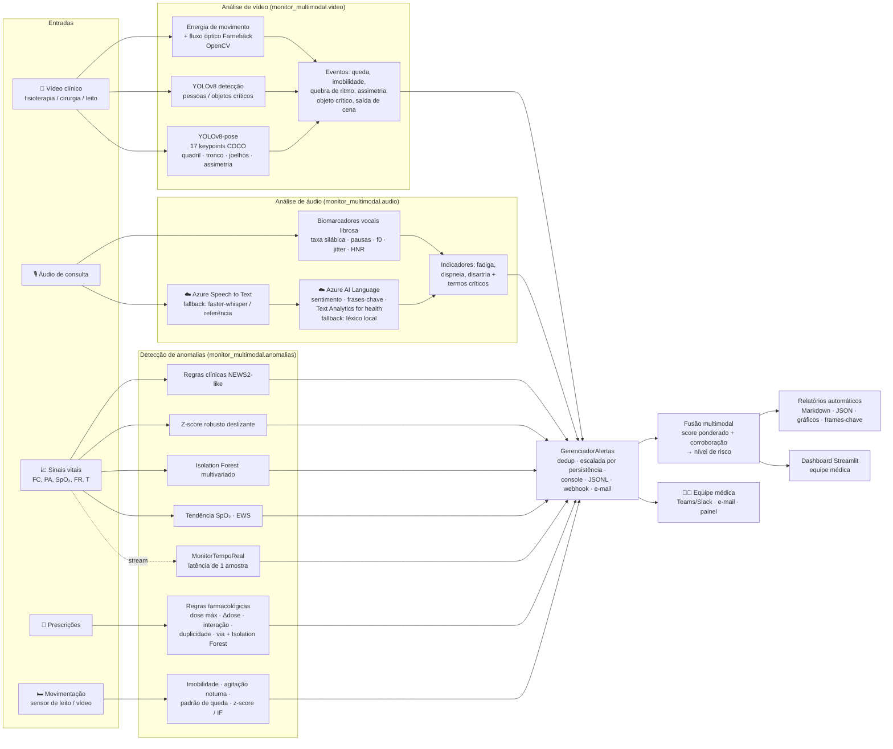

# Arquitetura do sistema

## Visão geral do fluxo multimodal

## Módulos

| Pacote | Responsabilidade | Principais classes/funções |
|---|---|---|
| `monitor_multimodal.config` | Caminhos, limiares clínicos, pesos da fusão, credenciais (.env) | `SINAIS_VITAIS`, `DOSE_MAXIMA_DIARIA_MG`, `PESOS_FUSAO` |
| `monitor_multimodal.anomalias.detectores` | Detectores genéricos reutilizáveis | `DetectorRegras`, `DetectorZScoreDeslizante`, `DetectorIsolationForest`, `DetectorEnsemble` |
| `monitor_multimodal.anomalias.sinais_vitais` | Séries de sinais vitais (lote) | `analisar_sinais_vitais`, `escore_alerta_precoce` |
| `monitor_multimodal.anomalias.stream` | Monitoramento em tempo real | `MonitorTempoReal`, `simular_stream` |
| `monitor_multimodal.anomalias.prescricoes` | Evolução de prescrições | `analisar_prescricoes` |
| `monitor_multimodal.anomalias.movimentacao` | Padrões de movimentação na internação | `analisar_movimentacao` |
| `monitor_multimodal.anomalias.avaliacao` | Métricas × rótulos injetados, tempo de antecipação | `metricas_binarias`, `tempo_antecipacao` |
| `monitor_multimodal.audio` | Biomarcadores vocais + pipeline de áudio | `extrair_features_vocais`, `indicadores_clinicos`, `analisar_audio` |
| `monitor_multimodal.azure_servicos` | Clientes Azure com fallback local | `transcrever` (Speech), `analisar_texto` (Language) |
| `monitor_multimodal.video` | Movimento, YOLOv8 detecção/pose, eventos | `calcular_movimento`, `DetectorObjetos`, `EstimadorPose`, `analisar_video` |
| `monitor_multimodal.alertas` | Gerenciador de alertas e canais | `Alerta`, `Severidade`, `GerenciadorAlertas` |
| `monitor_multimodal.fusao` | Fusão multimodal → perfil de risco | `fundir`, `PerfilRisco` |
| `monitor_multimodal.relatorios` | Relatórios Markdown/JSON + gráficos | `gerar_relatorio_paciente`, `gerar_relatorio_video`, `gerar_relatorio_geral` |
| `monitor_multimodal.dados_sinteticos` | Geração de dados com anomalias rotuladas | `gerar_tudo` |
| `monitor_multimodal.pipeline` | Orquestração ponta a ponta | `executar_demo` |
| `dashboard/app.py` | Painel Streamlit | — |
| `main.py` | CLI | `demo`, `stream`, `audio`, `video`, … |

## Fluxo de um alerta

1. Um detector identifica a anomalia e cria um `Alerta(paciente, fonte, tipo, severidade, mensagem, evidências, recomendação, score)`.
2. `GerenciadorAlertas.emitir` deduplica alertas iguais do mesmo paciente numa janela de 30 min; na 3ª repetição escala a severidade uma vez (persistência) e suprime o restante — evita fadiga de alarme.
3. O alerta é gravado em `outputs/alertas.jsonl`, mostrado no console e, conforme severidade, enviado ao webhook (≥ ALTA) e por e-mail (CRÍTICA).
4. A fusão agrupa alertas ≥ ALTA de modalidades distintas próximos no tempo em uma **corroboração multimodal**, que gera um alerta CRÍTICO adicional e eleva o score global.
5. O painel e os relatórios apresentam o alerta com a evidência (valor, z-score, frame-chave, trecho da transcrição) e a recomendação.

## Decisões de projeto

- **YOLOv8-pose em vez de OpenPose**: mesmos 17 keypoints COCO, instalação via `pip`, inferência em CPU; OpenPose exige compilação com CUDA/Caffe.
- **Late fusion (nível de decisão)**: cada modalidade é analisada por modelos especializados e produz score + alertas; a fusão combina decisões. É robusta à ausência de modalidades (um paciente pode não ter vídeo) e explicável.
- **Detectores complementares**: regras (conhecimento de domínio, explicável), estatística robusta no histórico do próprio paciente (personalizado, streaming) e Isolation Forest (interações multivariadas).
- **Fallback local para os serviços Azure**: o pipeline completo roda sem credenciais (transcrição de referência / léxico local), e usa Azure automaticamente quando as chaves existem (`MODO_SERVICOS=auto`). Azure Anomaly Detector não foi usado porque o serviço foi descontinuado pela Microsoft (aposentadoria em outubro de 2026); a detecção é feita localmente com scikit-learn.
- **Dados sintéticos rotulados**: dados reais de pacientes (PhysioNet/MIMIC) exigem credenciamento e não podem ser redistribuídos; os geradores reproduzem padrões fisiológicos plausíveis e permitem medir precisão/recall/antecipação.
